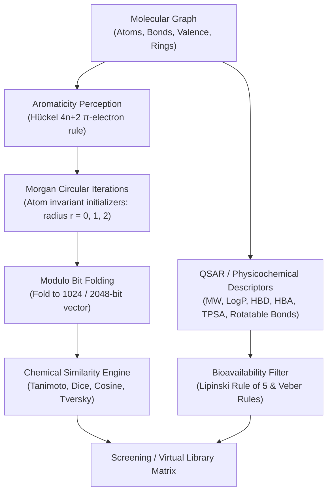

# MolSpectra

[](https://github.com/ZengLLQ/mol-spectra/actions)
[](LICENSE)
[](https://python.org/)
[]()

**MolSpectra** is a high-performance computational chemistry and cheminformatics engine in pure Python for topological molecular fingerprint generation (ECFP4 / ECFP6 Morgan circular fingerprints), pairwise chemical similarity matrix calculation, and oral drug-likeness/bioavailability screening (Lipinski's Rule of Five & Veber criteria).

---

## Architecture Pipeline



---

## Mathematical Formulations

### 1. Extended-Connectivity Morgan Fingerprints (ECFP)

For each atom $v$, the initial invariant $I_0(v)$ is computed from its atomic attributes:
$$I_0(v) = \text{Hash}\Big(\text{atomic\_num}(v), \text{heavy\_degree}(v), \text{implicit\_h}(v), \text{formal\_charge}(v), \text{is\_aromatic}(v)\Big)$$

In each circular expansion round $r \in \{1, \dots, R\}$:
$$I_r(v) = \text{Hash}\left(r, I_{r-1}(v), \text{lexicographical\_sort}\Big(\big\{\big(\text{bond\_order}(e), I_{r-1}(u)\big) : u \in \mathcal{N}(v)\big\}\Big)\right)$$

The bit position in a bit vector of length $M$ is obtained by uniform folding:
$$\text{bit\_index}(h) = h \pmod M$$

### 2. Chemical Similarity Metrics

Given two molecular fingerprints with active bit counts $a = |A|$, $b = |B|$, and intersection $c = |A \cap B|$:

- **Tanimoto / Jaccard Similarity**:
  $$T(A, B) = \frac{c}{a + b - c}$$
  The associated **Tanimoto Distance** $d_T(A, B) = 1 - T(A, B)$ satisfies all formal metric axioms including the triangle inequality:
  $$d_T(A, C) \le d_T(A, B) + d_T(B, C)$$

- **Sørensen-Dice Coefficient**:
  $$D(A, B) = \frac{2c}{a + b}$$

- **Cosine / Otsuka-Ochiai Coefficient**:
  $$C(A, B) = \frac{c}{\sqrt{a \cdot b}}$$

- **Asymmetric Tversky Index**:
  $$S(A, B; \alpha, \beta) = \frac{c}{c + \alpha(a - c) + \beta(b - c)}$$

### 3. Oral Drug-Likeness & Bioavailability Criteria

- **Lipinski's Rule of Five**:
  $$\text{MW} \le 500 \text{ Da}, \quad \log P \le 5.0, \quad \text{HBD} \le 5, \quad \text{HBA} \le 10$$
  A compound passes oral drug-likeness screening if violations $\le 1$.

- **Veber's Bioavailability Criteria**:
  $$\text{Rotatable Bonds} \le 10, \quad \text{TPSA} \le 140 \text{ \AA}^2$$

---

## CLI Usage

### List Reference Molecules

```bash
python -m molspectra.cli list
```

### Inspect Physicochemical and Lipinski Profile

```bash
python -m molspectra.cli info aspirin
```
Output:
```text
=== Molecular Specification: Aspirin ===
Chemical Formula     : C9H8O4
Molecular Weight     : 180.16 g/mol
Heavy Atom Count     : 13
Total Atom Count     : 21
Rings Detected       : 1

--- Lipinski's Rule of Five ---
LogP (lipophilicity) : 1.65 (criteria: <= 5.0)
H-Bond Donors (HBD)  : 1 (criteria: <= 5)
H-Bond Acceptors(HBA): 4 (criteria: <= 10)
Lipinski Violations  : 0 -> PASSED

--- Veber Bioavailability Profile ---
Rotatable Bonds      : 3 (criteria: <= 10)
TPSA (polar surface) : 63.60 A^2 (criteria: <= 140 A^2)
Veber Violations     : 0 -> PASSED
```

### Pairwise Chemical Similarity

```bash
python -m molspectra.cli similarity aspirin paracetamol
```

### Pairwise Cross-Similarity Matrix

```bash
python -m molspectra.cli matrix --metric tanimoto
```
Output:
```text
=== Cross-Similarity Matrix (Tanimoto, ECFP4) ===
               | benzene  | aspirin  | paraceta | ibuprofe | caffeine
---------------------------------------------------------------------
benzene        | 1.0000   | 0.1071   | 0.0800   | 0.0645   | 0.0571  
aspirin        | 0.1071   | 1.0000   | 0.2381   | 0.1837   | 0.1071  
paracetamol    | 0.0800   | 0.2381   | 1.0000   | 0.1739   | 0.1600  
ibuprofen      | 0.0645   | 0.1837   | 0.1739   | 1.0000   | 0.1034  
caffeine       | 0.0571   | 0.1071   | 0.1600   | 0.1034   | 1.0000  
```

---

## Installation & Testing

```bash
# Clone repository
git clone https://github.com/ZengLLQ/mol-spectra.git
cd mol-spectra

# Install in development mode
pip install -e .

# Run test suite
pytest -v
```

---

## License

MIT License. See [LICENSE](LICENSE) for full details.
